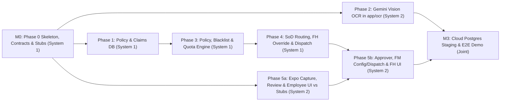
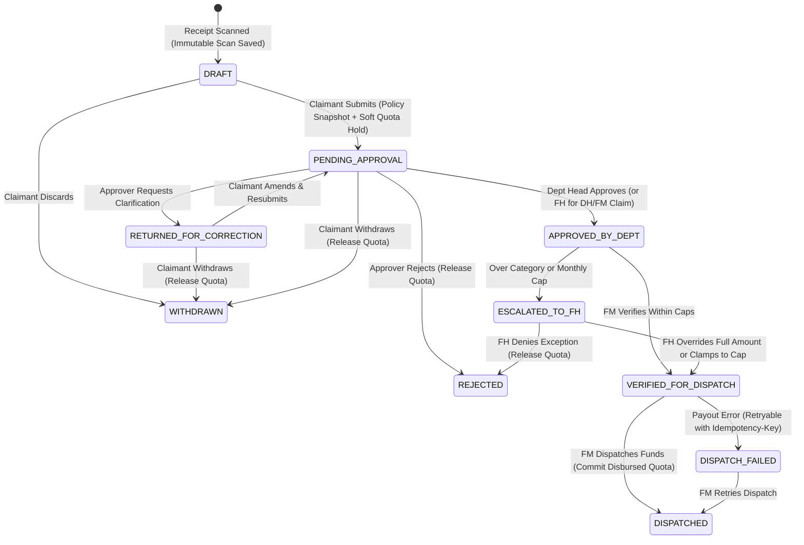

# ExpenseIt — Phase 0 Synchronization & Foundation Plan

This document specifies the **Phase 0 Foundation & Collaboration Synchronization** baseline for **ExpenseIt**, aligning [plan.md](./plan.md) across **System 1 (`@Tharnikaa`)** and **System 2 (Collaborator)** so two independent Antigravity agents can execute Phases 1–5 in parallel with zero merge collisions, schema drift, or blocked UI screens.

> [!IMPORTANT]
> **Solo Phase 0 Bootstrap Rule:** **System 1** scaffolds and verifies Phase 0 solo on `main` and `develop` before **System 2** clones and cuts feature branches. Once Phase 0 lands, System 2 is 100% unblocked via `contracts/openapi.yaml`, stateful stub endpoints for every route, pinned persona UUIDs, `OCRServiceProtocol`, and the React Native / Expo shell.

---

## 1. Locked Architectural & Business Decisions

| Area | Locked Decision |
|---|---|
| **Backend Stack** | `Python 3.12` + `FastAPI` + `Pydantic v2` + `SQLAlchemy 2.0` + `Alembic` + `PyJWT` / `pwdlib` |
| **Mobile Client Stack** | **React Native + Expo** (`TypeScript`, `Expo Router`, `NativeWind v4` + typed Teal tokens, `@tanstack/react-query`, `expo-image-picker`, `expo-image-manipulator`, `expo-secure-store`) |
| **Database Setup** | **SQLite (`WAL` mode + `BEGIN IMMEDIATE`)** for zero-install local dev + **Cloud PostgreSQL (Neon / Supabase free tier)** via `DATABASE_URL` for shared staging & `SELECT ... FOR UPDATE` row-locking tests |
| **Git Topology** | `main` (production/milestone releases) + `develop` (shared integration branch); all implementation work via PRs from `feature/*` branches |
| **Ownership Split** | **System 1:** Phase 0 scaffold, `backend/` (except `app/ocr/`), and **all** Alembic migrations.<br>**System 2:** `backend/app/ocr/**` (behind `OCRServiceProtocol`) + `mobile/**` (all mobile screens, including FM category/limit admin UI).<br>**Shared (`contracts/**`):** Dual approval required via `.github/CODEOWNERS` + CI validation. |
| **Currency & Money** | **`INR` (`₹`)** only in MVP; all monetary values stored and serialized as **integer paise** (`amount_paise: int`, e.g., `₹500.00 = 50000`); non-INR receipts flagged by OCR and blocked at policy check |
| **Roles vs. Spend Tiers** | **4 RBAC Roles** (`EMPLOYEE`, `DEPT_HEAD`, `FINANCE_MANAGER`, `FINANCE_HEAD`) separated from dynamic **Spend Tiers** (`JUNIOR`, `SENIOR`, `MANAGER`) |
| **Approval Routing & SoD** | Hard invariant `actor_id != claimant_id` everywhere.<br>• `EMPLOYEE -> DEPT_HEAD -> FINANCE_MANAGER`<br>• `DEPT_HEAD -> FINANCE_HEAD -> FINANCE_MANAGER`<br>• `FINANCE_MANAGER -> FINANCE_HEAD -> peer FINANCE_MANAGER`<br>• `FINANCE_HEAD` does not submit personal claims in MVP (`403`) |
| **Blacklist & Over-Cap Rules** | OCR returns factual `item_tag` labels only. Policy engine auto-excludes blacklisted items from `eligible_amount_paise`, allows submission with warnings, and routes over-cap claims to `ESCALATED_TO_FH` for Finance Head override or cap clamping |
| **Monthly Quota Ledger** | Calendar month (`YYYY-MM`) in **`Asia/Kolkata` (IST)** based on **`invoice_date`** (tax-inclusive), soft-reserving quota on submit (`reserved_paise`), releasing on reject/withdraw, and committing to `disbursed_paise` on dispatch with an immutable `policy_snapshot` |

---

## 2. Target Monorepo Layout & Ownership Map

```text
Budget_classify/
├── AGENTS.md                        # Shared rules loaded automatically by both Antigravity agents
├── COLLABORATION.md                 # Git workflow, LAN Expo setup, contract change protocol
├── plan.md                          # Master Product & Architecture Plan
├── PHASE_0_PLAN.md                  # Phase 0 Synchronization Specification (this file)
├── .python-version                  # 3.12
├── .nvmrc                           # 24
├── .github/
│   ├── CODEOWNERS                   # Enforces PR review boundaries per directory
│   ├── pull_request_template.md     # Contract/migration/test verification checklist
│   └── workflows/ci.yml             # Schema validation + pytest + Expo tsc
├── contracts/                       # [DUAL SIGN-OFF REQUIRED]
│   ├── openapi.yaml                 # OpenAPI 3.1 spec covering all v1 endpoints
│   ├── seed_policies.json           # Seeded roles, tiers, 7 categories, INR paise caps
│   ├── seed_personas.json           # Fixed UUIDs for 7 deterministic test personas
│   └── schemas/
│       ├── receipt_extracted.schema.json
│       ├── expense_claim.schema.json
│       ├── notification.schema.json
│       └── seed_policies.schema.json
├── docs/
│   ├── architecture.md              # System context, LAN Expo <-> FastAPI guide
│   └── state-machine.md             # 10-state transition table, SoD guards, quota math
├── tests/
│   └── fixtures/receipts/           # Canonical synthetic receipt images + expected OCR JSON
├── backend/                         # [SYSTEM 1 OWNED — except app/ocr/]
│   ├── .env.example                 # APP_ENV, DATABASE_URL, JWT_SECRET, GEMINI_API_KEY
│   ├── pyproject.toml
│   ├── alembic.ini
│   ├── migrations/                  # SOLE OWNER: System 1 (prevents Alembic multi-head conflicts)
│   ├── app/
│   │   ├── main.py                  # 0.0.0.0 CORS, router mounts, dev-only route guard
│   │   ├── core/                    # Settings, JWT auth, RBAC & SoD dependencies, DB session
│   │   ├── models/                  # SQLAlchemy 2.0 ORM models
│   │   ├── schemas/                 # Pydantic v2 models matching contracts/openapi.yaml
│   │   ├── ocr/                     # [SYSTEM 2 OWNED — Phase 2 Vision AI]
│   │   │   ├── protocol.py          # Frozen OCRServiceProtocol interface
│   │   │   ├── mock_provider.py     # Deterministic Phase 0 preset scanner
│   │   │   └── gemini_provider.py   # Phase 2 Gemini Multimodal implementation target
│   │   ├── services/                # StorageService, NotificationService, StubStore
│   │   └── api/v1/                  # Stateful Phase 0 stub routers for 100% of endpoints
│   └── tests/                       # Contract, RBAC/SoD, and production-guard unit tests
└── mobile/                          # [SYSTEM 2 OWNED after Phase 0 shell]
    ├── .env.example                 # EXPO_PUBLIC_API_URL=http://<LAN_IP>:8000/api/v1
    ├── app.json                     # Expo config (camera/media permissions, scheme: expenseit)
    ├── package.json
    ├── tsconfig.json
    └── src/
        ├── app/                     # Expo Router: (auth), (tabs)/{index,claims,snap,profile}
        ├── api/                     # generated.ts (openapi-typescript) + Bearer fetch wrapper
        ├── components/              # DevRoleSwitcher (__DEV__ gated), NotificationDrawer
        ├── utils/                   # image.ts (HEIC->JPEG <= 2048px normalization)
        └── theme/                   # tokens.ts (WCAG 2.1 AA Teal Light & Dark palettes)
```

### Backend OCR Adapter Contract (`backend/app/ocr/protocol.py`)
System 2 implements Gemini Vision inside `backend/app/ocr/` against this interface without needing to edit `main.py` or Alembic migrations:

```python
class ActiveCategoryItem(TypedDict):
    code: str          # e.g., "MEALS", "TRAVEL"
    name: str          # e.g., "Meals & Refreshments"
    description: str

class OCRServiceProtocol(Protocol):
    async def extract_receipt(
        self,
        image_bytes: bytes,
        mime_type: str,
        active_categories: Sequence[ActiveCategoryItem],
    ) -> ExtractedReceiptPayload: ...
```

---

## 3. Parallel Execution Graph & Milestones



---

## 4. Seeded Personas, Categories & Claim State Machine

### 4.1 Deterministic Seed Personas (`contracts/seed_personas.json`)
Fixed UUIDs ensure Role Switcher tokens, mock claims, and UI tests behave identically on both laptops:

1. **Junior Employee (`Engineering`):** `role=EMPLOYEE`, `spend_tier=JUNIOR`
2. **Senior Employee (`Engineering`):** `role=EMPLOYEE`, `spend_tier=SENIOR`
3. **Department Head (`Engineering`):** `role=DEPT_HEAD`, `spend_tier=MANAGER`
4. **Department Head (`Sales`):** `role=DEPT_HEAD`, `spend_tier=MANAGER` *(tests cross-department BOLA isolation)*
5. **Finance Manager 1:** `role=FINANCE_MANAGER`, `spend_tier=MANAGER`
6. **Finance Manager 2:** `role=FINANCE_MANAGER`, `spend_tier=MANAGER` *(verifies/dispatches FM-1's personal claims for SoD)*
7. **Finance Head (Overseer):** `role=FINANCE_HEAD`, `spend_tier=NONE`

### 4.2 Default Seeded INR Limits (`contracts/seed_policies.json`)

| Category Code | Display Name | `JUNIOR` Cap (`₹` / paise) | `SENIOR` Cap (`₹` / paise) | `MANAGER` Cap (`₹` / paise) |
|---|---|---|---|---|
| `MEALS` | Meals & Refreshments | `₹500` (`50000`) | `₹1,200` (`120000`) | `₹2,500` (`250000`) |
| `TRAVEL` | Local & Intercity Travel | `₹2,000` (`200000`) | `₹5,000` (`500000`) | `₹12,000` (`1200000`) |
| `LODGING` | Hotel & Lodging | `₹3,500` (`350000`) | `₹6,500` (`650000`) | `₹12,000` (`1200000`) |
| `OFFICE_SUPPLIES` | Office Supplies | `₹1,000` (`100000`) | `₹2,500` (`250000`) | `₹5,000` (`500000`) |
| `SOFTWARE_TOOLS` | Software & Subscriptions | `₹1,500` (`150000`) | `₹4,000` (`400000`) | `₹10,000` (`1000000`) |
| `INTERNET_PHONE` | Internet & Mobile | `₹1,000` (`100000`) | `₹1,500` (`150000`) | `₹2,500` (`250000`) |
| `OTHER` | Miscellaneous Business | `₹500` (`50000`) | `₹1,500` (`150000`) | `₹3,000` (`300000`) |
| **Monthly Cumulative Cap** | *All Categories Combined (IST Month)* | **`₹15,000` (`1500000`)** | **`₹40,000` (`4000000`)** | **`₹85,000` (`8500000`)** |

### 4.3 Unified 10-State Claim Lifecycle



---

## 5. Contract Suite & OpenAPI 3.1 Endpoint Inventory

### 5.1 Schema Fixes Applied in Phase 0
1. **`contracts/schemas/receipt_extracted.schema.json` (`v1.0.0`):**
   * Integer minor units (`total_amount_paise`, `subtotal_amount_paise`, `tax_amount_paise`).
   * Nullable `vendor_name` and `invoice_date` for damaged receipts + `is_valid_receipt: boolean` + `detected_currency: string`.
   * Per-field `field_confidence` (`vendor`, `date`, `total`, `category` in `[0.0, 1.0]`) so the Expo Review Screen highlights low-confidence fields.
   * Dynamic `suggested_category_code` string + factual `item_tag` (`meal`, `alcohol`, `tobacco`, `gift_card`, `personal`, `lodging`, `transport`, `office_supply`, `software`, `tax_fee`, `other`) replacing `is_flagged_blacklisted`.
2. **`contracts/schemas/expense_claim.schema.json` (`v1.0.0`):**
   * Full linkage (`receipt_id`, `claimant_id`, `role`, `spend_tier`, `department_id`, `line_items[]`, `ocr_diff`, `policy_snapshot`, `total_amount_paise`, `blacklisted_deduction_paise`, `eligible_amount_paise`, `approved_amount_paise`, 10-state `status`, `events[]`).
3. **`contracts/schemas/notification.schema.json` (`v1.0.0`):**
   * 8 event types + `actor_id` + `deep_link` (`expenseit://claims/{id}`).
4. **`contracts/seed_policies.json` + `contracts/schemas/seed_policies.schema.json` (`v1.0.0`):**
   * Cleanly separates seed configuration data from its JSON Schema validator.

### 5.2 Complete Stubbed API Surface (`contracts/openapi.yaml`)

| Domain | Endpoints Stubbed in Phase 0 |
|---|---|
| **Auth & Dev Switcher** | `POST /api/v1/auth/login`, `GET /api/v1/auth/me`, `POST /api/v1/auth/dev-switch-role` (`APP_ENV=development` only) |
| **Categories & Limits** | `GET /api/v1/categories`, `POST /api/v1/categories`, `GET /api/v1/policies/limits`, `PUT /api/v1/policies/limits`, `GET /api/v1/quotas/me` |
| **Receipts & OCR** | `POST /api/v1/ocr/scan`, `POST /api/v1/ocr/mock-scan` (presets: `clean_meal`, `hotel_with_alcohol`, `over_cap_flight`, `blurry_missing_date`, `foreign_usd`), `GET /api/v1/receipts/{id}/image` |
| **Claims** | `POST /api/v1/claims/precheck`, `POST /api/v1/claims` (`Idempotency-Key`), `GET /api/v1/claims`, `GET /api/v1/claims/{id}`, `PATCH /api/v1/claims/{id}`, `POST /api/v1/claims/{id}/withdraw` |
| **Workflow & Finance** | `POST /api/v1/claims/{id}/approve`, `POST /api/v1/claims/{id}/return`, `POST /api/v1/claims/{id}/reject`, `POST /api/v1/claims/{id}/verify`, `POST /api/v1/claims/{id}/override`, `POST /api/v1/claims/{id}/dispatch` (`Idempotency-Key`) |
| **Notifications & Audit** | `GET /api/v1/notifications`, `POST /api/v1/notifications/{id}/read`, `POST /api/v1/devices/push-token`, `GET /api/v1/analytics/overview`, `GET /api/v1/audit-logs` |

---

## 6. Phase 0 Implementation Checklist & Exit Criteria

- [ ] **Step 1 — Governance & Docs:** Commit `AGENTS.md`, `COLLABORATION.md`, `docs/architecture.md`, `docs/state-machine.md`, `.python-version` (`3.12`), `.nvmrc` (`24`), `.github/CODEOWNERS`, and `.github/pull_request_template.md`.
- [ ] **Step 2 — Contracts & Fixtures:** Author `contracts/openapi.yaml`, `contracts/schemas/*.schema.json`, `contracts/seed_policies.json`, `contracts/seed_personas.json`, and `tests/fixtures/receipts/`.
- [ ] **Step 3 — FastAPI Stateful Stub Server (`backend/`):** Implement JWT + RBAC + SoD dependencies, `APP_ENV=development` Role Switcher guard, SQLite WAL + Cloud Postgres SQLAlchemy 2.0 session, `OCRServiceProtocol`, `StorageService`, `NotificationService`, and stateful routers for every endpoint in `openapi.yaml`.
- [ ] **Step 4 — React Native / Expo Shell (`mobile/`):** Scaffold Expo Router 4-tab layout (`Home`, `Claims`, `Snap (+)`, `Profile`), WCAG AA Teal Light/Dark theme provider, `__DEV__` Role Switcher banner, Notification Drawer shell, `expo-image-manipulator` JPEG normalizer, and generated `openapi-typescript` API client.
- [ ] **Step 5 — CI & Verification Gate:** Configure `.github/workflows/ci.yml`; pass 100% of `pytest` contract/SoD/security tests and `npx tsc --noEmit` in `mobile/`.
- [ ] **Step 6 — Branch Split Ready:** Merge Phase 0 to `main` and `develop` so System 2 can branch `feature/phase-2-ocr-pipeline` and `feature/phase-5a-mobile-capture`.
