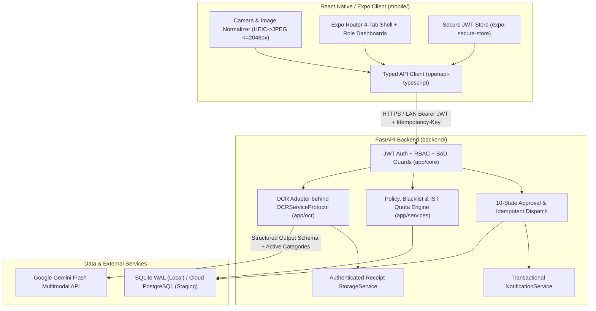
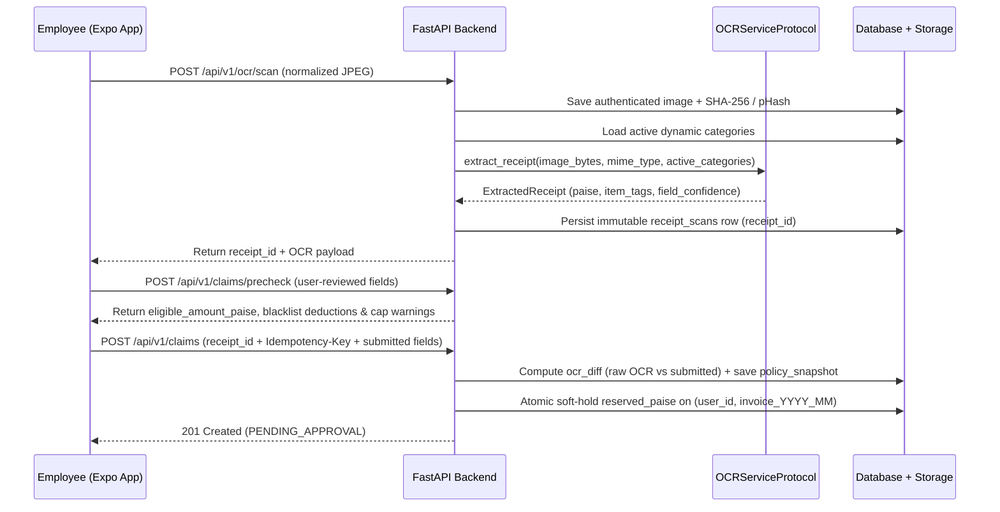

# ExpenseIt — System Architecture (`docs/architecture.md`)

## 1. System Context & Component Boundaries

---

## 2. Anti-Tampering Receipt Scan & Claim Submission Flow

---

## 3. Database Portability: SQLite WAL (Local) vs. Cloud PostgreSQL (Staging)

1. **Zero-Install Local Development (`sqlite:///./expenseit_dev.db`)**:
   - SQLAlchemy connection hook automatically executes:
     - `PRAGMA journal_mode=WAL;`
     - `PRAGMA busy_timeout=5000;`
     - `PRAGMA foreign_keys=ON;`
   - Quota reservation wraps checks and updates inside `BEGIN IMMEDIATE` transactions to serialize concurrent local writes.
2. **Cloud PostgreSQL Staging (`postgresql+psycopg://...`)**:
   - Uses `SELECT ... FOR UPDATE` (`query.with_for_update()`) on the `(user_id, year_month)` quota ledger row to prevent Time-of-Check-to-Time-of-Use (TOCTOU) cap races across concurrent API workers.
   - All money columns use `BIGINT` (`*_paise`), avoiding dialect float precision differences.

