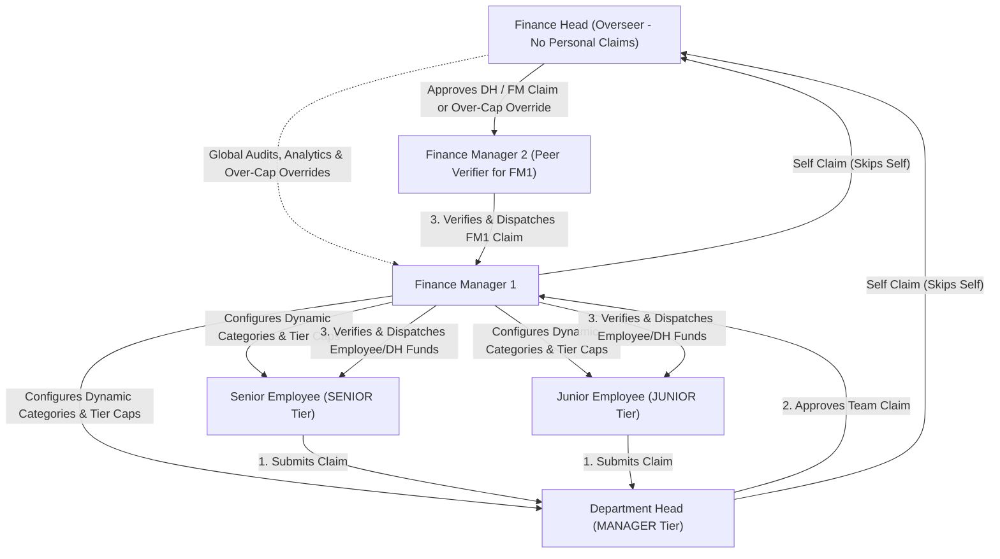
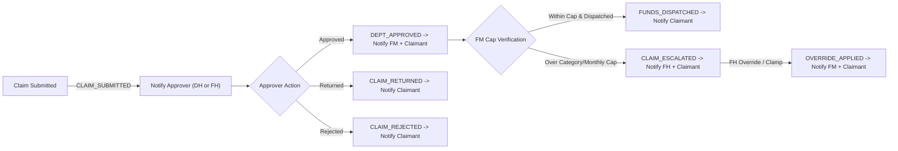

# ExpenseIt: Master Implementation & Collaboration Plan

> **Synchronized Baseline:** See [PHASE_0_PLAN.md](./PHASE_0_PLAN.md) for the complete Phase 0 Synchronization & Foundation specification, contract schemas, stateful stub inventory, and dual-Antigravity ownership rules.

## 1. Project Overview
**ExpenseIt** is an automated corporate expense classification and policy validation system built for a native mobile experience. Employees snap a picture of a receipt, and the system automatically extracts details via Vision AI, classifies expenses against dynamic categories, checks category and cumulative monthly limits in **INR (`₹`)**, deducts blacklisted items, and routes reimbursements across a separation-of-duties (SoD) approval hierarchy.

* **Application Name:** ExpenseIt
* **Client Platform:** **React Native + Expo** (`TypeScript`, `Expo Router`, `NativeWind v4` + typed theme tokens) supporting Android, iOS, and Expo Web (`>= 48px` touch targets)
* **Backend Stack:** **Python 3.12** + **FastAPI** + **Pydantic v2** + **SQLAlchemy 2.0** + **Alembic** + Bearer **JWT** authentication
* **Database Strategy:** **SQLite (`WAL` mode)** for zero-install local development + **Cloud PostgreSQL (Neon / Supabase)** via `DATABASE_URL` for shared staging and row-locking concurrency tests
* **Currency & Money Precision:** **`INR` (`₹`)** only in MVP, stored and transmitted as **integer paise** (`amount_paise`, e.g., `₹500.00 = 50000`)
* **Visual Theme:** **Teal Modern FinTech** (WCAG 2.1 AA compliant Light & Deep Teal Dark modes with Mauve secondary accents)

---

## 2. Multi-Tier Role, Spend Tier & Permission Architecture

ExpenseIt decouples **RBAC Roles** (permissions) from dynamic **Spend Tiers** (policy caps) and enforces a strict **Separation of Duties (`actor_id != claimant_id`)** rule at every approval, verification, override, and dispatch step:

| Persona | RBAC `role` | `spend_tier` | Key Capabilities | Routing & Policy Authority |
|---|---|---|---|---|
| **Finance Head** *(Overseer)* | `FINANCE_HEAD` | `NONE` | • Enterprise-wide spending analytics & immutable audit logs. • Approves personal claims raised by Dept Heads & Finance Managers. • Resolves `ESCALATED_TO_FH` over-cap claims (override full amount, clamp to cap, or reject). | Global oversight; **does not submit personal claims in MVP**. |
| **Finance Manager** | `FINANCE_MANAGER` | `MANAGER` | • Configures expense categories & spend limits for `JUNIOR`, `SENIOR`, and `MANAGER` tiers. • Verifies claims against monthly IST quota ledger. • Dispatches reimbursements (`Idempotency-Key` protected). | Owns spend limit matrices & fund disbursement; **own claims routed to FH -> peer FM**. |
| **Department Head** | `DEPT_HEAD` | `MANAGER` | • Reviews, approves, returns for correction, or rejects department team claims. • Can raise personal claims governed by `MANAGER` tier caps. | Approves own department's employee claims; **own claims routed to Finance Head**. |
| **Senior Employee** | `EMPLOYEE` | `SENIOR` | • Captures receipts, edits/reviews OCR output, and submits claims. • Views personal monthly remaining quota & claim timeline. | Governed by `SENIOR` tier caps (`₹40,000`/month seeded default). |
| **Junior Employee** | `EMPLOYEE` | `JUNIOR` | • Captures receipts, edits/reviews OCR output, and submits claims. • Views personal monthly remaining quota & claim timeline. | Governed by `JUNIOR` tier caps (`₹15,000`/month seeded default). |

---

## 3. Claim Workflow & Notification Architecture

### 3.1 Policy, Blacklist & Quota Rules
* **Dynamic Categories:** Managed in DB (`MEALS`, `TRAVEL`, `LODGING`, `OFFICE_SUPPLIES`, `SOFTWARE_TOOLS`, `INTERNET_PHONE`, `OTHER`) and passed dynamically into the Gemini Vision OCR prompt.
* **Blacklist Auto-Deduction:** OCR outputs factual `item_tag` labels (`alcohol`, `tobacco`, `gift_card`, `personal`, `meal`, etc.). The Policy Engine automatically deducts blacklisted line items from `total_amount_paise` to compute `eligible_amount_paise`.
* **IST Calendar Month Quota:** Monthly limits apply to calendar months (`YYYY-MM` in `Asia/Kolkata`) keyed by **`invoice_date`** (tax-inclusive). Submitting a claim places a **soft hold (`reserved_paise`)** on the user's monthly ledger, released on rejection/withdrawal or committed to `disbursed_paise` on dispatch, alongside an immutable `policy_snapshot`.
* **Over-Cap Escalation:** Claims exceeding category or remaining monthly caps allow submission with warnings and transition to `ESCALATED_TO_FH` for Finance Head override or cap clamping.

### 3.2 Notification Flow & Data Model
Transactional in-app notifications (30s foreground polling in Phase 0 + Expo Push token hook via `NotificationService`):

* `id`: UUID
* `user_id`: Target recipient UUID
* `actor_id`: Triggering user UUID
* `type`: `CLAIM_SUBMITTED` | `DEPT_APPROVED` | `CLAIM_RETURNED` | `CLAIM_REJECTED` | `CLAIM_ESCALATED` | `OVERRIDE_APPLIED` | `FUNDS_DISPATCHED` | `POLICY_LIMIT_UPDATED`
* `title` & `message`: Short summary and context
* `claim_id`: Nullable claim UUID reference
* `deep_link`: Expo Router URI (e.g., `expenseit://claims/{id}`)
* `is_read`: Boolean (default `false`)
* `created_at`: ISO-8601 UTC timestamp

---

## 4. Phase-by-Phase Roadmap & Ownership

Collaboration is split between **System 1 (You / `@Tharnikaa`)** and **System 2 (Friend)**, both running Antigravity governed by root `AGENTS.md` and `.github/CODEOWNERS`:

| Phase | Description | Owner | Owned Paths & Deliverables |
|---|---|---|---|
| **Phase 0** | **Foundation & Synchronization** *(Solo Setup first)* | **System 1 (You)** | `AGENTS.md`, `CODEOWNERS`, `contracts/openapi.yaml` + JSON Schemas, INR seed data, FastAPI stateful stubs for **all** routes, Expo Router shell + Teal AA tokens, GitHub Actions CI. See [PHASE_0_PLAN.md](./PHASE_0_PLAN.md). |
| **Phase 1** | **Data Modeling & Policy DB** | **System 1 (You)** | `backend/app/models/**`, `backend/migrations/**` (sole migration owner): SQLAlchemy 2.0 tables, categories, tiers, quota ledger, immutable `receipt_scans` & `audit_logs`. |
| **Phase 2** | **Receipt OCR & Vision AI** | **System 2 (Friend)** | `backend/app/ocr/**` (behind `OCRServiceProtocol`): Image validation, `pHash` + `SHA-256`, Gemini Flash Multimodal structured extraction with per-field confidence. |
| **Phase 3** | **Policy & Quota Verification Engine** | **System 1 (You)** | `backend/app/services/policy/**`: Blacklist item deduction, INR currency check, duplicate fingerprint check, IST monthly quota soft-holds, `ocr_diff` tamper tracking. |
| **Phase 4** | **Claims Workflow & Disbursement Engine** | **System 1 (You)** | `backend/app/services/workflow/**`: 10-state machine, SoD routing, `ESCALATED_TO_FH` override/clamp actions, idempotent FM fund dispatch, transactional notifications. |
| **Phase 5** | **React Native / Expo Mobile Client** | **System 2 (Friend)** | `mobile/**`: Camera/gallery capture (`expo-image-manipulator`), confidence-highlighted review screen, Employee/DH/FM/FH role dashboards, and **FM category & limit settings UI**. |
| **Phase 6** | **Cloud Postgres Staging & E2E Hardening** | **Joint** | Neon/Supabase PostgreSQL concurrency verification, E2E test suite across all 5 personas, demo readiness. |

---

## 5. Design System: Teal Modern FinTech (WCAG 2.1 AA Verified)

### Semantic Color Tokens (`mobile/src/theme/tokens.ts`)

| Token | Light Mode | Dark Mode | Contrast & Usage |
|---|---|---|---|
| `background` / `surface` | `#F0FDFA` / `#FFFFFF` | `#041E1D` / `#0D2D2A` | App canvas & elevated cards |
| `primary` / `onPrimary` | `#0F766E` / `#FFFFFF` | `#14B8A6` / `#041E1D` | Primary CTAs & active states (`5.47:1` Light, `7.31:1` Dark — WCAG AA compliant) |
| `accent` / `onAccent` | `#6D28D9` / `#FFFFFF` | `#A78BFA` / `#0F172A` | Secondary Mauve highlights & override badges |
| `border` | `#CCFBF1` | `#134E4A` | Card & input hairlines |
| `textPrimary` / `textMuted` | `#0F172A` / `#475569` | `#F0FDFA` / `#94A3B8` | Primary copy & metadata labels |
| `success` / `warning` / `danger` / `info` | `#15803D` / `#B45309` / `#B91C1C` / `#0369A1` | `#4ADE80` / `#FBBF24` / `#F87171` / `#38BDF8` | Approval pills, cap/confidence warnings, blacklist deductions |

### Core Mobile Shell Components
1. **Bottom Tab Bar (`>= 48px` touch targets + safe-area insets):** Thumb-friendly navigation across `Home`, `Claims`, `Snap (+)`, and `Profile`.
2. **Notification Drawer:** Bell icon with unread badge count, deep-linking directly to claim detail screens.
3. **Dev-Only Role Switcher Toolbar:** Instant persona switching across seeded test users — **strictly gated** behind `APP_ENV == "development"` on the backend (`404` otherwise) and `__DEV__` in the Expo client.

---

## 6. Antigravity-to-Antigravity Collaboration Rules

### 1. Single Source of Truth (`/contracts`)
* `contracts/openapi.yaml`: Complete OpenAPI 3.1 specification driving FastAPI schemas and generated Expo TypeScript types (`openapi-typescript`).
* `contracts/schemas/*.schema.json`: Versioned JSON Schemas (`receipt_extracted`, `expense_claim`, `notification`, `seed_policies`).
* Contract modifications require a dedicated PR approved by **both** collaborators and validated by GitHub Actions CI.

### 2. Full-Surface Stateful Stubs in Phase 0
* Phase 0 ships stateful FastAPI stub routers for **every** OpenAPI endpoint (auth, dynamic categories, OCR presets, precheck, claims CRUD, DH/FH approvals & overrides, FM limit config & dispatch, notifications, analytics) backed by pinned UUID personas in `contracts/seed_personas.json` so Phase 5 never blocks on Phases 1, 3, or 4.

### 3. Environment Variables & Local Device Networking
* **Never commit `.env` files.** Share variable names only via `backend/.env.example` and `mobile/.env.example`.
* Bind local FastAPI dev server to `0.0.0.0:8000` so physical phones running Expo Go on local Wi-Fi connect seamlessly via `EXPO_PUBLIC_API_URL=http://<LAN_IP>:8000/api/v1`.
* Each developer uses an independent free Gemini API key from [Google AI Studio](https://aistudio.google.com) in `backend/.env` to isolate rate limits.

### 4. Git Branching Strategy
* `main`: Stable milestone & production branch (protected).
* `develop`: Shared integration branch (protected; default PR target after Phase 0).
* **System 1 (You) branches:** `feature/phase-1-policy-db`, `feature/phase-3-verification-engine`, `feature/phase-4-claims-workflow`.
* **System 2 (Friend) branches:** `feature/phase-2-ocr-pipeline`, `feature/phase-5a-mobile-capture`, `feature/phase-5b-role-dashboards`.
